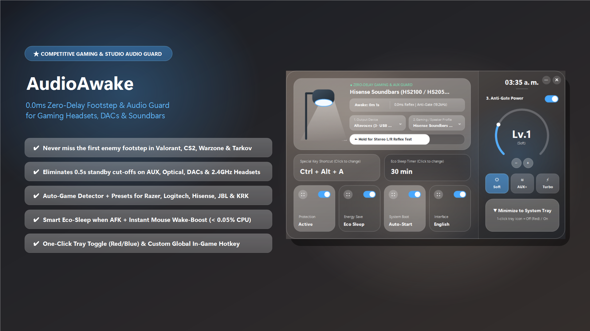
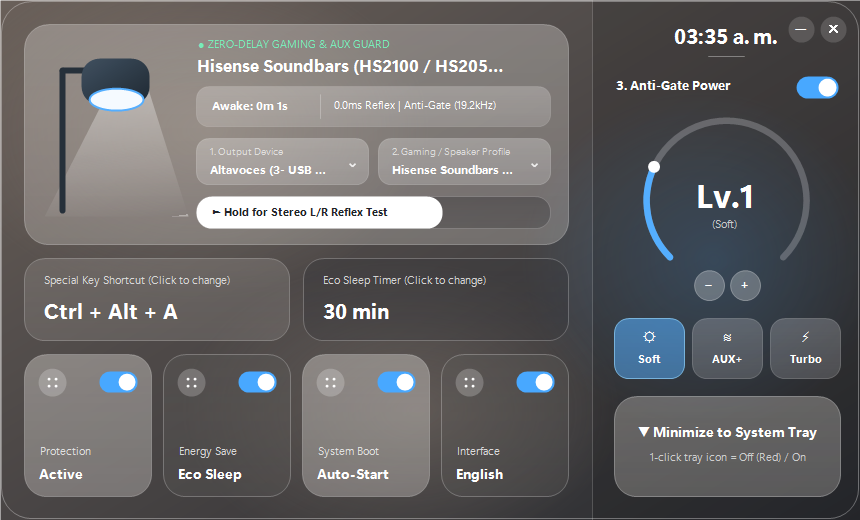
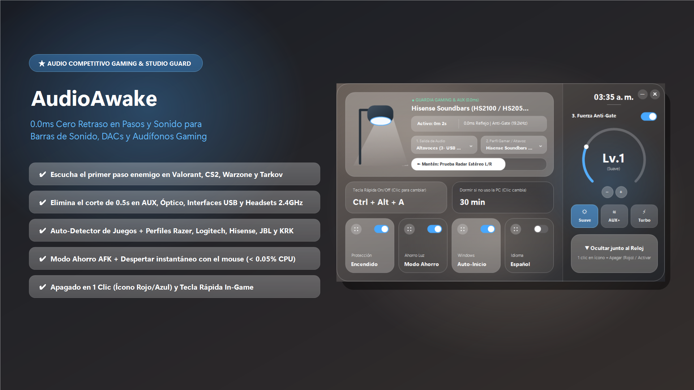
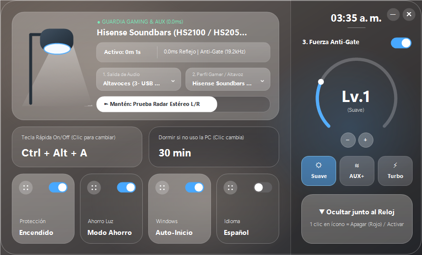

# ⚡ AudioAwake — Gaming & Studio Edition

### **0.0ms Zero-Delay Footstep & Audio Standby Guard for Windows 10 / 11**
*Never miss the first enemy footstep in Valorant, CS2, Warzone & Tarkov. Prevents Gaming Headsets, DACs, Soundbars & Studio Monitors from entering micro-sleep.*

[-2563eb?style=for-the-badge)](#)

 

 

### [⬇️ **Download AudioAwake v1.0.0 (Portable Windows x64 ZIP)**](../../releases/latest)

---

## 🎮 Why Competitive Gamers & Studio Creators Need AudioAwake

### **1. The "Silent First Footstep" Bug in Competitive Gaming**
When holding an angle in silence in **VALORANT, Counter-Strike 2, Call of Duty: Warzone, Escape from Tarkov, Rainbow Six Siege, or Apex Legends**, modern **2.4GHz Wireless Headsets** (*Logitech G Pro X, Razer BlackShark, SteelSeries Arctis, HyperX*), **Gaming Soundbars** (*Razer Leviathan, Sound Blaster Katana*), and **External USB DACs** (*Behringer, Focusrite, Sound Blaster, Astro*) enter a hardware **power-saving micro-sleep / noise-gate state** after just 2–3 seconds of silence.

When an enemy takes a single step or reloads, the amplifier takes **0.5 to 1.2 seconds** to wake up—**completely swallowing the first footstep sound**.

### **2. Soundbars & Studio Monitors Cutting Off Audio**
Home theater soundbars (**Hisense HS2100/AX, Samsung, JBL, Sony, LG, Bose**) and active studio monitors (**KRK Rokit, Edifier, PreSonus, Yamaha**) connected via **AUX, Optical (SPDIF), or Bluetooth** shut off their internal Class-D amplifier during silence, cutting off the beginning of songs, YouTube videos, and Windows notifications.

---

## ✨ How AudioAwake Solves It (0.0 ms Wake Delay)

**AudioAwake** synthesizes a real-time, mathematically generated **Hybrid Anti-Gate Pilot (`38 Hz Sub-Carrier + 19.2 kHz Ultrasonic Pilot + Micro-Dither`)** that passes through hardware high-pass filters to keep your DAC and amplifier stage **100% open continuously**—with **zero audible sound** to the human ear.

- 🎮 **Auto-Game Detector:** Automatically detects when **VALORANT, CS2, Warzone, Tarkov, Fortnite, Apex, Overwatch 2, Dota 2, or LoL** is running and locks your audio channel at `0.0 ms` readiness.
- 🎧 **Stereo L/R Radar Reflex Test:** Built-in left/right stereo radar test to verify instant imaging and zero wake-up lag before entering a match.
- 🎯 **Gaming & Studio Presets:** Ready-to-use profiles for *Gaming Soundbars (Razer/Katana)*, *2.4GHz Wireless Headsets*, *USB Audio Interfaces/DACs*, *Hisense/Samsung/JBL Soundbars*, and *KRK Studio Monitors*.
- 🌙 **Smart AFK Eco-Sleep + Instant Mouse Wake-Boost:** Lets your speakers rest when you leave your PC for `15–120 minutes`, and wakes them up the exact millisecond you touch your mouse.
- 🔴 **1-Click Tray Toggle & In-Game Hotkey:** Left-click the tray icon to pause (turns **Red**) or resume (turns **Blue**), or toggle inside any full-screen game with your custom shortcut (`Ctrl + Alt + A`).

  

---

## 🇪🇸 Edición Gaming & Estudio en Español

  

### **¿Qué soluciona AudioAwake en Juegos y Equipos de Sonido?**
- **En Juegos Competitivos (*Valorant, CS2, Warzone, Tarkov*):** Evita que tus audífonos inalámbricos 2.4GHz, DACs USB o barras gaming entren en *micro-reposo* cuando estás en silencio esperando a un enemigo, logrando **0.0 ms de retraso** para que siempre escuches el primer paso o recarga.
- **En Barras de Sonido y Monitores (*Hisense HS2100, Samsung, JBL, KRK, Edifier*):** Supera la puerta de ruido (*Noise-Gate*) del cable AUX, Óptico o Bluetooth para que nunca se corte el primer medio segundo de tus videos, canciones o notificaciones.

  

---

  Developed with ❤️ by <a href="https://github.com/astostudio"><b>AstoStudio</b></a>

